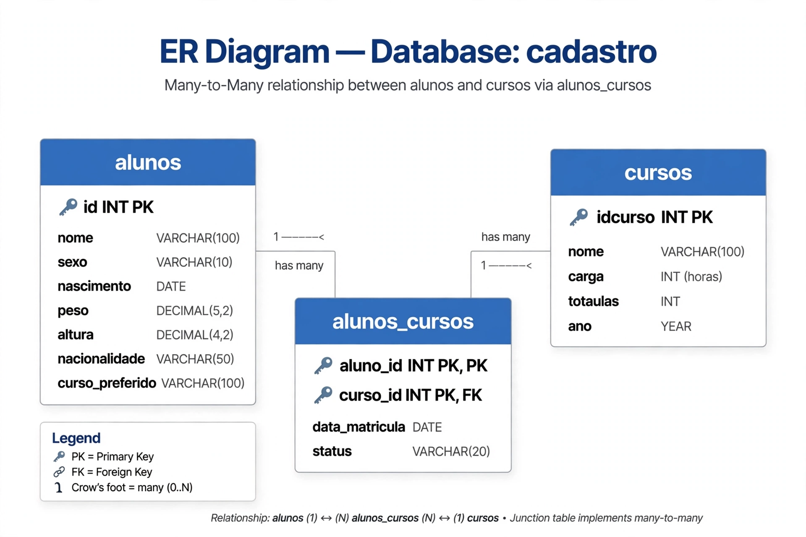

# 🎓 MySQL - Sistema de Cadastro de Alunos e Cursos | 20 Análises


> Projeto de Banco de Dados relacional para portfólio de Análise de Dados, com modelagem, povoamento e 20 exercícios de SQL organizados por nível.

**Repositório:** `julianoberdet/mysql-cadastro-alunos-cursos`

### 📌 Sobre o Projeto
Banco `cadastro` com duas tabelas principais (`gafanhotos` / `alunos` e `cursos`) modelado para praticar desde `SELECT` básico até `JOIN`, `GROUP BY`, `SUBQUERIES` e análise de dados reais. Ideal para quem está migrando para Data Analytics.

- **Origem dos dados:** Cursos de MySQL do Curso em Vídeo, com extensão para N:N
- **Registros:** 50+ alunos com atributos físicos e preferências
- **Objetivo:** Simular um cenário real com dados sujos e órfãos

### 🗺️ Diagrama ER


**Estrutura:**
- `alunos` (id, nome, sexo, nascimento, nacionalidade, curso_preferido, peso, altura)
- `cursos` (idcurso, nome, carga, totaulas, ano)
- `alunos_cursos` (tabela de junção para matrícula N:N)

### 💡 Os 20 Exercícios - Organizados por Nível

**🟢 NÍVEL 1: Básico (SELECT, WHERE)**
1.  Listar todos os alunos
2.  Filtrar por sexo e nacionalidade
3.  Buscar por curso preferido com LIKE

**🟡 NÍVEL 2: Filtros Avançados e Ordenação**
4.  Alunos nascidos entre 1990 e 2000
5.  TOP 10 alunos mais pesados / mais leves
6.  Ordenar por altura e peso

**🟠 NÍVEL 3: Agregação**
7.  COUNT - Total de alunos por sexo
8.  AVG, MAX, MIN - Média de peso e altura por sexo
9.  GROUP BY - Cursos mais procurados

**🔴 NÍVEL 4: JOIN e Relações**
10.  INNER JOIN - Alunos com curso preferido existente
11.  LEFT JOIN - Identificar registros órfãos (sem curso preferido)
12.  JOIN com N:N - Alunos matriculados e seus cursos

**⚫ NÍVEL 5: Subqueries e Casos Reais**
13.  Alunos com peso acima da média
14.  Curso com maior carga horária
15.  Alunos que não escolheram curso
16.  Cursos sem alunos interessados
17.  Relatório de chute de dados - LEFT JOIN + IS NULL
18.  Ranking de cursos por procura
19.  Programadores + nome do curso + carga
20.  TOP 3 cursos de 2016 mais pesados + insights

### 🔍 Insights Encontrados
- Mais de 50 registros órfãos sem curso preferido - trabalhado com `LEFT JOIN + IS NULL`
- Ranking dos 3 cursos mais procurados
- Cursos com maior carga vs. perfil de peso dos alunos - ideal para storytelling

### 🚀 Como Rodar
```bash
# 1. Clone
git clone https://github.com/julianoberdet/mysql-cadastro-alunos-cursos.git

# 2. No MySQL Workbench / Terminal
CREATE DATABASE cadastro;
USE cadastro;
SOURCE banco/cadastro.sql;
SOURCE banco/dados.sql;

# 3. Rode as análises
SOURCE analises/20-exercicios.sql